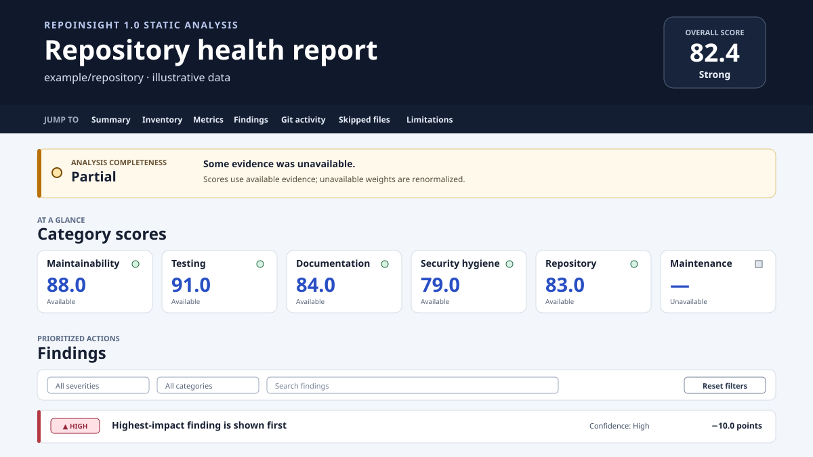

# RepoInsight

**RepoInsight 1.2.0** adds offline saved-report comparison with
`repoinsight compare before.json after.json`. Version 1.1.0 has no comparison
command. See the
[comparison guide](docs/comparison.md) and [before/after examples](docs/examples/report-comparison.md).

RepoInsight is a cross-platform Python CLI that produces deterministic repository-health reports without importing or executing repository code. It analyzes local directories and public GitHub repositories with bounded file discovery, Python AST inspection, sanitized Git metadata, transparent scoring, a versioned JSON contract, and a standalone offline HTML report.



## Install

RepoInsight requires **Python 3.11+**. Install from
[production PyPI](https://pypi.org/project/repoinsight/) in a virtual environment.
Installation and static analysis require no OpenAI API key.

On Windows PowerShell:

```powershell
python -m venv .venv
.\.venv\Scripts\python.exe -m pip install --upgrade repoinsight
.\.venv\Scripts\repoinsight.exe version
```

On macOS/Linux:

```sh
python3 -m venv .venv
source .venv/bin/activate
python -m pip install --upgrade repoinsight
repoinsight version
```

For the commands below, Windows users should replace `python` with
`.\.venv\Scripts\python.exe` and `repoinsight` with `.\.venv\Scripts\repoinsight.exe`;
activation is not needed. On macOS/Linux, `.venv/bin/python` and
`.venv/bin/repoinsight` also work without activation.

To install the exact 1.2.0 release instead:

```console
python -m pip install "repoinsight==1.2.0"
```

Alternatively, download the 1.2.0 wheel and `SHA256SUMS` from the
[GitHub release](https://github.com/HHP8/RepoInsight/releases/tag/v1.2.0), verify
the checksum, and install the downloaded wheel in the same environment:

```console
python -m pip install ./repoinsight-1.2.0-py3-none-any.whl
repoinsight version
```

See [Experimental AI guidance](#experimental-ai-guidance-110) for optional AI
dependencies, or [Development from a source checkout](#development-from-a-source-checkout)
for an editable developer installation.

## Quick start

```console
repoinsight analyze .
repoinsight analyze . --output reports --format all
repoinsight analyze https://github.com/pypa/sampleproject --output reports
repoinsight analyze . --fail-under 80
repoinsight rules
repoinsight explain RI-SEC-001
```

`analyze` prints a compact terminal summary. JSON and HTML output default to `repoinsight-report/`. The HTML file has no server or network dependency.

## Safety and privacy

Repository contents are untrusted input. RepoInsight never imports analyzed modules or runs repository scripts, build tools, tests, hooks, or configuration code. It blocks ordinary traversal and external symlink following, bounds discovery and Git acquisition, redacts secret-like text at trust boundaries, autoescapes report data, and removes temporary clones.

Version 1 does not defend against a concurrent privileged local attacker, a compromised operating system, a malicious system Git installation, a hostile executable `PATH`, or an adversarial filesystem driver. See [Security and privacy](docs/security.md) and [Known limitations](docs/limitations.md).

## Documentation

- [CLI reference](docs/cli.md)
- [Configuration](docs/configuration.md)
- [Rules](docs/rules.md)
- [Scoring](docs/scoring.md)
- [Architecture](docs/architecture.md)
- [Analyzer extension guide](docs/analyzers.md)
- [Security and privacy](docs/security.md)
- [Known limitations](docs/limitations.md)
- [Release process](docs/release.md)
- [Proposed upgrade plan: AI guidance and future improvements](docs/upgrade-plan.md)
- [AI enrichment examples](docs/examples/ai-guidance.md)
- [AI release evaluation](docs/ai-evaluation.md)
- [Codex Cloud development](docs/codex-cloud.md)
- [Support](SUPPORT.md)

## Development from a source checkout

Use an editable installation with the development dependency group. On Windows:

This source checkout identifies new reports as tool 1.2.0 and accepts saved
1.0.0, 1.1.0 and 1.2.0 reports. Static schema/scoring and comparison contracts
remain 1.0. Older strict validators may reject the new tool metadata and need
updated packaged schemas; unknown future tool versions remain unsupported.

```console
python -m venv .venv
.venv\Scripts\python -m pip install -e . --group dev
.venv\Scripts\python -m pytest -q
.venv\Scripts\python -m ruff format --check .
.venv\Scripts\python -m ruff check .
.venv\Scripts\python -m mypy src tests tools benchmarks
```

On macOS or Linux:

```console
python3 -m venv .venv
.venv/bin/python -m pip install -e . --group dev
.venv/bin/python -m pytest -q
.venv/bin/python -m ruff format --check .
.venv/bin/python -m ruff check .
.venv/bin/python -m mypy src tests tools benchmarks
```

The standard test suite needs no network access. The 100,000-line benchmark and live public-repository smoke are opt-in. See [CONTRIBUTING.md](CONTRIBUTING.md).

## Experimental AI guidance (1.1.0)

The optional experimental implementation can explain a saved report and suggest
up to two evidence-linked actions. The published 1.0.0 package has no `enrich`.
Version 1.2.0 is available on PyPI. In the same virtual environment, install the
optional AI dependencies:

```console
python -m pip install --upgrade "repoinsight[ai]"
```

Developers can instead install the optional transport from a source checkout with
`python -m pip install -e ".[ai]"`. Then preview a saved report or explicitly send it:

```console
repoinsight analyze . --output reports
repoinsight enrich reports/repoinsight-report.json --preview --model MODEL_ID
repoinsight enrich reports/repoinsight-report.json --send --model MODEL_ID --output ai-reports
```

Replace `MODEL_ID` with a model available to your account that supports the OpenAI
Responses API and Structured Outputs. Installation and preview require no API key;
live `--send` mode requires `OPENAI_API_KEY` supplied only through the local process
environment. Do not put key values in source, application
settings or reports. Release and CI validation need no personal API key. Preview requires no key or network access and
prints the exact JSON request; only `--send` transmits selected static evidence.
Source code, repository identity, Git identities, paths, and repository prose are
omitted from that request. Paths appear locally in the separate AI JSON/HTML reports.
Existing saved reports and static scores stay unchanged. New static reports identify
the producing tool as 1.2.0; schema and score-contract identifiers remain 1.0.
AI guidance may fail after a paid request when reasoning exhausts the output cap.
The default 1500-token cap does not guarantee complete JSON. See the
[workflow](docs/examples/ai-guidance.md) and
[privacy details](docs/security.md#experimental-ai-enrichment).

## License

MIT. See [LICENSE](LICENSE).
