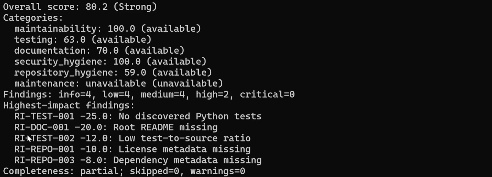
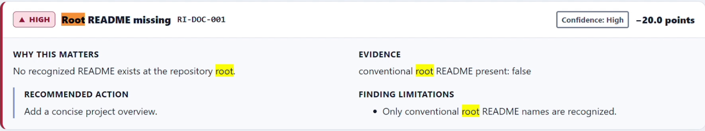
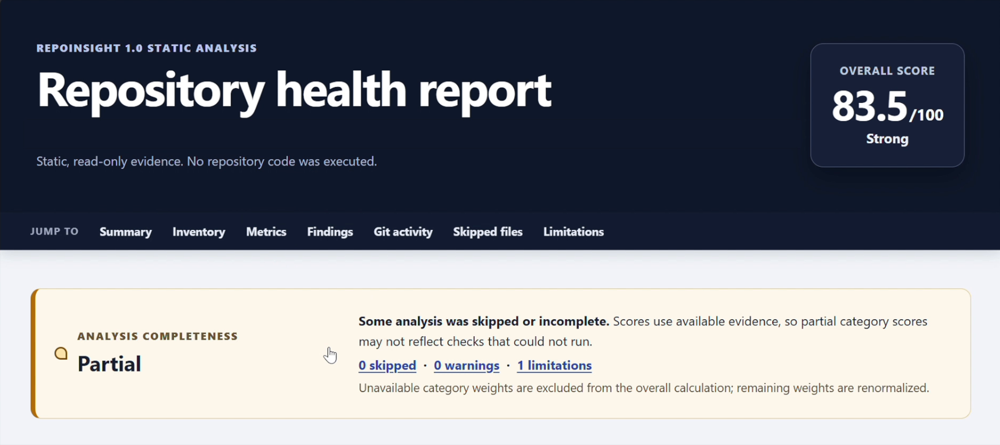

# Find a missing README with RepoInsight

*By Hossein · A beginner-friendly companion to the recorded demo*

I built RepoInsight with Codex, and it is the project I have spent the most time on among my Codex projects. It analyzes Python projects and turns repository evidence into readable reports. In this walkthrough, I’ll use a tiny example to show how one finding can become a clear documentation task.

By the end, you’ll be able to generate a report, understand **Root README missing**, and check what changes after a README is added. You don’t need an OpenAI API key.

[Watch the 2:02 video](https://www.youtube.com/watch?v=EQs8uK4E_T0) · [Explore RepoInsight on GitHub](https://github.com/HHP8/RepoInsight)

## The example

The companion files contain two versions of a synthetic teaching project:

```text
sample-before/          sample-after/
  totals.py               totals.py
                          README.md
```

The [Python file](sample-before/totals.py) defines a function that adds item prices. It is byte-for-byte identical in both folders. The only added file is the [README](sample-after/README.md).

RepoInsight performs **static analysis**: it reads files without importing or executing the project’s source or running its tests. This exercise checks report behavior; it does not test the sample program.

You can read along using the screenshots below before installing anything. The commands generate your own before and after reports locally; generated reports are not stored in this repository.

## 1. Set up the tool

You’ll need Python 3.11 or newer and internet access for installation. The local analysis and saved HTML reports then work offline.

On the [repository page](https://github.com/HHP8/RepoInsight), choose **Code → Download ZIP** and extract the archive outside any existing Git checkout. Open the extracted repository folder (usually `RepoInsight-main`), then `docs/tutorials/first-health-report`. Keep its sample folders and images together. If you already cloned the repository, copy this entire tutorial folder outside the checkout first: a parent Git repository can change the history evidence and scores.

Open PowerShell in the `first-health-report` folder and run:

```powershell
python -m venv .venv
.\.venv\Scripts\python.exe -m pip install "repoinsight==1.2.0"
.\.venv\Scripts\python.exe -m repoinsight version
```

The first command creates an isolated Python environment. The second installs the version used here. Using its Python executable directly means you don’t need to activate the environment.

Expected version output:

```text
RepoInsight 1.2.0 (JSON schema 1.0)
```

On macOS/Linux, create the environment with `python3 -m venv .venv`, then use `.venv/bin/python` in place of `.\.venv\Scripts\python.exe`. Use paths such as `./sample-before` and `./reports/before` in the analysis commands. You can open the HTML files through your file manager instead of using `Start-Process`.

## 2. Analyze the project without a README

```powershell
.\.venv\Scripts\python.exe -m repoinsight analyze .\sample-before --output .\reports\before --format all
```

`--output` chooses where to save the reports. `--format all` creates both `repoinsight-report.json` and `repoinsight-report.html`. The first run creates the output folder; rerunning the command replaces reports in that folder. Keep these generated files local: they can contain paths identifying your machine. GitHub displays HTML files as source, so open your generated HTML report locally in a browser.

The terminal summarizes category scores, findings, completeness, and report locations. Look for these lines among the output:

```text
Overall score: 80.2 (Strong)
RI-DOC-001 -20.0: Root README missing
Completeness: partial; skipped=0, warnings=0
```



*Video, 0:30: the first analysis results. The screenshot is cropped to the summary, with local report paths excluded.*

The tiny sample deliberately lacks tests and other project infrastructure, so you’ll see several findings. We’ll focus on one that is easy to inspect.

## 3. Understand “Root README missing”

Open the report:

```powershell
Start-Process .\reports\before\repoinsight-report.html
```

In **Findings**, search for `RI-DOC-001` using **Search findings**, then expand **Root README missing**. “Root” means the top level of the project folder—the same folder that contains `totals.py` in this example.



*Video, 1:00: the expanded finding. The recording uses the browser’s Find feature, which highlights “root”; the report’s own search also lets you find the rule.*

Read the card in three parts:

- **Evidence:** `conventional root README present: false`. RepoInsight did not find a recognized README in the project’s top-level folder.
- **Recommended action:** add a concise project overview. Give a new reader a starting point: purpose, installation, and usage.
- **Limitation:** only conventional root README names are recognized. Documentation elsewhere may still exist, so inspect the folder before deciding what to change.

The rule is labeled **high** severity and shows **−20.0 points**. That deduction belongs to the **documentation category**; it is not a 20-point deduction from the overall score. It also does not establish that the Python program is broken.

You can read the rule’s explanation in the terminal too:

```powershell
.\.venv\Scripts\python.exe -m repoinsight explain RI-DOC-001
```

## 4. Check the version with a README

The [README in `sample-after`](sample-after/README.md) explains the sample’s purpose, states that it needs Python 3.11 or newer with no third-party dependencies, and gives a usage command with expected output. It also says that the sample has no automated test suite.

Analyze this second folder:

```powershell
.\.venv\Scripts\python.exe -m repoinsight analyze .\sample-after --output .\reports\after --format all
Start-Process .\reports\after\repoinsight-report.html
```

In the after report, search for `RI-DOC-001` again. It is absent. Other findings remain.



*Video, 1:24: the report after adding the README. The video shows the second analysis and report; the README itself is provided in the companion files. The template’s “1.0 static analysis” label remains visible; the installed tool version is 1.2.0.*

For these samples with RepoInsight 1.2.0, the results are:

| Result | Before | After |
|---|---:|---:|
| Documentation score | 70 | 90 |
| Overall score | 80.2 | 83.5 |
| Total findings | 14 | 13 |
| `RI-DOC-001` | Present | Absent |
| Analysis completeness | Partial | Partial |

Both reports are **partial** because Git history is unavailable in these plain sample folders. If you analyze a different folder, use a different version, or supply Git history, your results may differ.

The useful observation is specific: the missing-README finding is no longer observed after a README is present, while the Python file is unchanged. A higher score does not prove that the documentation is excellent, the program works, or the code is secure. Read the README yourself and check whether its instructions make sense.

RepoInsight also has a saved-report comparison command. If you explore it separately, its `no_longer_observed` label means a finding was absent in the later report—not that a fix was independently verified. This walkthrough follows the two analysis runs shown in the video.

## How Codex fits

For me, RepoInsight is a concrete tool built with Codex: something I can run, inspect, and explain through a small reproducible example. The accompanying video is a newly recorded product demonstration using my own voice and screen recordings, rather than footage of the original development process.

RepoInsight also includes optional, experimental OpenAI API guidance for explaining saved findings and suggesting actions. No live API request was part of this demonstration.

## Try one finding on your own project

Use a separate output folder and replace `./sample-before` with the path to your Python project. Start with one finding you understand, check its evidence and limitations, and decide whether a change would help a reader or maintainer.

See the [installation guide](../../../README.md#install), [rule catalog](../../rules.md), and [scoring documentation](../../scoring.md). Keep the report beside your own review: the score is a static indicator, and the finding is a starting point for a decision.
